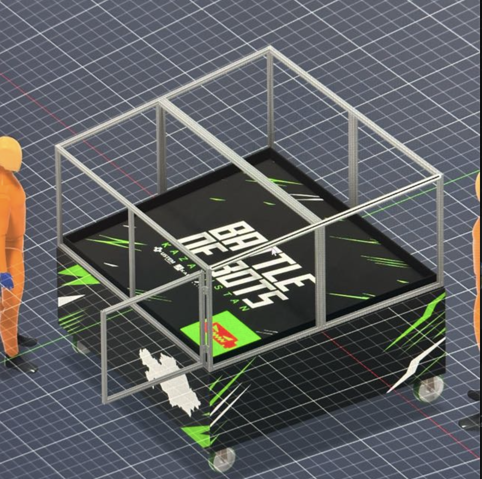

# Box Battle of Bots Kazakhstan

Роботтар жекпе-жегіне арналған физикалық арена және оны басқаратын жүйе. Бұл репозиторийде аренаның 3D рендері, жарық пен дыбыстың қосылу схемасы, ESP32 микробағдарламасы және үш тілдегі оператор нұсқаулығы жиналған.

*Аренаның 3D жобасы.*

## Жоба бөліктері

| Бөлік | Құрамы |
|---|---|
| Арена | Қаңқасы, есігі, дөңгелекті тұғыры және брендтелген алаңы көрсетілген 3D рендер |
| Басқару | ESP32, YK04 пульті, RGB/W жарығы, күшейткіш және арена хабарламалары |
| Телефон | Қазақша, орысша және ағылшынша веб-басқару, дыбыс файлдарының кітапханасы және жергілікті HTTPS арқылы микрофон |

## Құжаттар және код

- [Қосылу схемасы және GPIO кестесі](docs/wiring.md)
- [Үш тілдегі техникалық нұсқаулық](docs/Technical-Manual.pdf)
- [ESP32 микробағдарламасы және құрастыру қадамдары](arena-controller/README.md)
- [Телефондағы веб-интерфейс](media/controller-preview.png)

## Қысқа іске қосу

1. Арена құрамдарын [қосылу схемасына](docs/wiring.md) сай тексеріңіз.
2. [ArenaController.ino](arena-controller/ArenaController/ArenaController.ino) файлындағы `wifiPassword` үлгі мәнін өз құпиясөзіңізге ауыстырыңыз. Код ESP32 Dev Module және Arduino ESP32 core 4.0.0 үшін дайындалған.
3. Кодты ESP32-ге жүктегеннен кейін телефонды **BoxBot-Arena** желісіне қосып, браузерде [192.168.4.1](http://192.168.4.1/) ашыңыз.

Нұсқаулықта пульттің 15 командасы, сайттың 16 командасы, раунд пен жеңімпазды жариялау реті және алғашқы іске қосу тексерісі берілген. Микрофонды браузер мен жергілікті HTTPS деңгейінде сынадық. Телефоннан арена динамигіне дейінгі сынақ әлі расталмаған.
