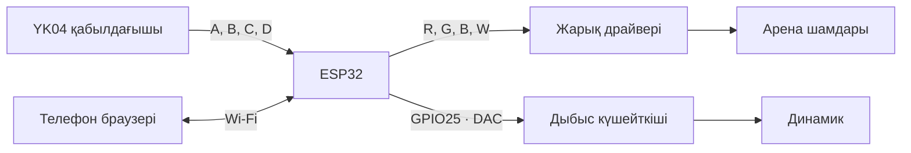

# Арена контроллерінің қосылуы

| Бағыт | Сигнал | ESP32 |
|---|---|---|
| YK04 → ESP32 | A · сол жоғары | GPIO21 |
| YK04 → ESP32 | B · оң жоғары | GPIO18 |
| YK04 → ESP32 | C · сол асты | GPIO22 |
| YK04 → ESP32 | D · оң асты | GPIO19 |
| ESP32 → жарық драйвері | Қызыл · R | GPIO32 |
| ESP32 → жарық драйвері | Жасыл · G | GPIO26 |
| ESP32 → жарық драйвері | Көк · B | GPIO27 |
| ESP32 → жарық драйвері | Ақ · W | GPIO14 |
| ESP32 → күшейткіш кірісі | Аналог дыбыс · DAC | GPIO25 |

Қуатты ажыратып барып жалғаңыз. YK04 және ESP32 үшін ортақ GND қолданыңыз. Қабылдағыш шығысының кернеуі 3,3 В-тан жоғары болса, деңгей түрлендіргіш керек. Жарық пен динамикке өз драйвері және күшейткіші арқылы қосылыңыз. Таспадағы қорек кернеуі мен полярлығын нақты модульдің таңбасынан тексеріңіз.

Фото және қосылыстарды тексеру реті [техникалық нұсқаулықта](Technical-Manual.pdf) берілген.
